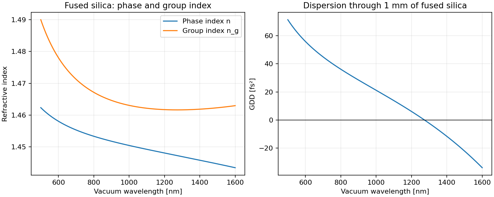

PyOptik
========

.. list-table::
   :width: 100%
   :widths: 35 65
   :header-rows: 1

   * - Badge
     - Status
   * - Python versions
     - |mps-python|
   * - Documentation
     - |mps-docs|
   * - Tests
     - |mps-ci| |mps-coverage|
   * - PyPI
     - |mps-pypi| |mps-downloads|
   * - Conda
     - |mps-conda| |mps-conda-downloads| |mps-conda-release|

A package for refractive index values.

Select a measured optical dataset or dispersion model, then evaluate refractive index
over a wavelength range. Use wavelength quantities with explicit units, check the
source validity range, and cite the dataset used in your calculation.

See the `usage guide <https://github.com/MartinPdeS/PyOptik/blob/HEAD/USAGE.rst>`__ for further examples and implementation details.

Installation
------------

Requires Python ``>=3.10``.

.. code-block:: console

   $ python -m pip install PyOptik

Install from the ``martinpdes`` Conda channel:

.. code-block:: console

   $ conda install -c martinpdes pyoptik

For an editable source installation:

.. code-block:: console

   $ git clone https://github.com/MartinPdeS/PyOptik.git
   $ cd PyOptik
   $ python -m pip install -e .

Calculate silica dispersion
---------------------------

.. code-block:: python

   """
   Plot the Refractive Index of Optical Material: Silica
   =====================================================

   This module demonstrates the usage of the PyOptik library to calculate and plot the refractive index of the optical material Silica glass over a specified range of wavelengths.

   """

   # %%
   from TypedUnit import ureg
   from PyOptik import MaterialCatalog

   # Initialize the material with the Sellmeier model
   catalog = MaterialCatalog.from_snapshot()
   material = catalog.get("main/SiO2/Malitson").load()

   # Calculate refractive index at specific wavelengths
   RI = material.compute_refractive_index(wavelength=[1310, 1550] * ureg.nanometer)

   # Display calculated refractive indices at sample wavelengths
   material.plot()

   Wavelength dependence of the silica refractive index.

Documentation
-------------

Use the `PyOptik documentation <https://martinpdes.github.io/PyOptik/>`__ to work through
examples and look up the inputs and return values of individual functions.

Contributing
------------

Bug reports, worked examples, and documentation corrections are welcome.
To set up a development checkout and run the tests, follow the `contributing guide <https://github.com/MartinPdeS/PyOptik/blob/HEAD/CONTRIBUTING.md>`__.

Contact
-------

For questions, contact `Martin Poinsinet de Sivry-Houle <mailto:martin.poinsinet.de.sivry@gmail.com?subject=PyOptik>`__.

License
-------

See the `PyOptik license <https://github.com/MartinPdeS/PyOptik/blob/HEAD/LICENSE>`__ for terms of use.

.. |mps-python| image:: https://img.shields.io/pypi/pyversions/pyoptik.svg
   :alt: Supported Python versions
   :target: https://pypi.org/project/pyoptik/

.. |mps-pypi| image:: https://img.shields.io/pypi/v/pyoptik.svg
   :alt: PyPI version
   :target: https://pypi.org/project/pyoptik/

.. |mps-downloads| image:: https://img.shields.io/pypi/dm/pyoptik.svg
   :alt: Monthly PyPI downloads
   :target: https://pypistats.org/packages/pyoptik

.. |mps-docs| image:: https://github.com/MartinPdeS/PyOptik/actions/workflows/deploy_documentation.yml/badge.svg
   :alt: Documentation
   :target: https://martinpdes.github.io/PyOptik/

.. |mps-ci| image:: https://github.com/MartinPdeS/PyOptik/actions/workflows/tests.yml/badge.svg
   :alt: Tests
   :target: https://github.com/MartinPdeS/PyOptik/actions/workflows/tests.yml

.. |mps-conda| image:: https://anaconda.org/martinpdes/pyoptik/badges/version.svg
   :alt: Anaconda version
   :target: https://anaconda.org/martinpdes/pyoptik

.. |mps-conda-downloads| image:: https://anaconda.org/martinpdes/pyoptik/badges/downloads.svg
   :alt: Anaconda downloads
   :target: https://anaconda.org/martinpdes/pyoptik

.. |mps-conda-release| image:: https://anaconda.org/martinpdes/pyoptik/badges/latest_release_relative_date.svg
   :alt: Latest Anaconda release
   :target: https://anaconda.org/martinpdes/pyoptik
