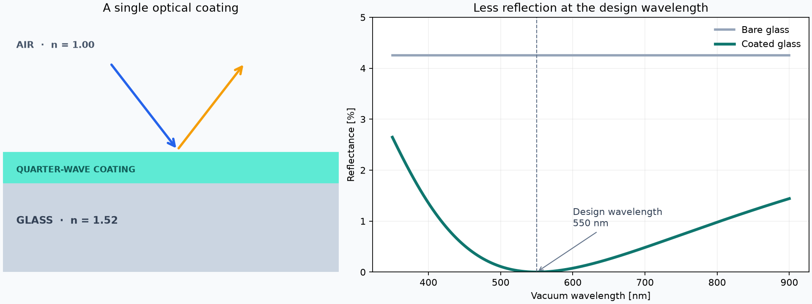
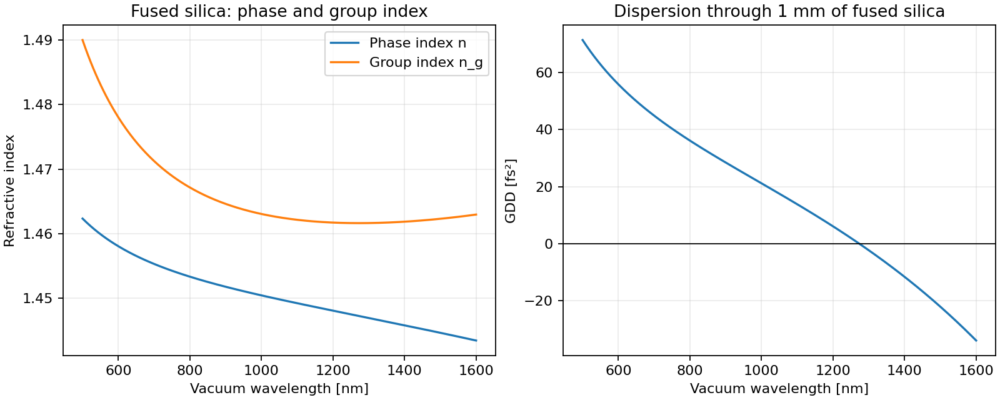
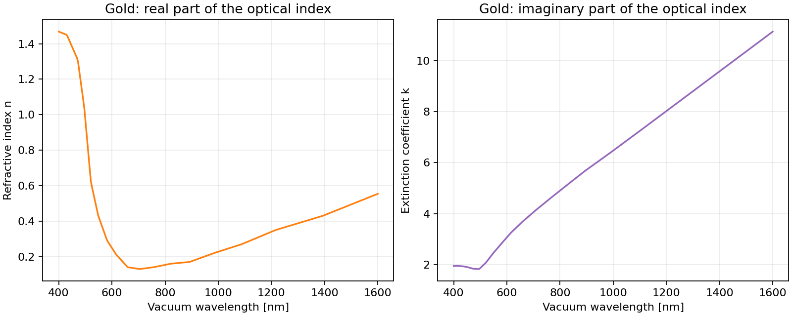

|logo|

PyOptik
=======

**Optical materials and thin films, from data to calculation.** PyOptik is an
open-source Python package for wavelength-dependent optical constants,
dispersion, Fresnel interfaces, and coherent thin-film stacks. It brings the
`RefractiveIndex.INFO database <https://refractiveindex.info/>`_ into
unit-aware Python workflows while preserving the source of each dataset.

|python| |docs| |ci/cd| |coverage| |PyPi| |anaconda|

Features
--------

* Find materials by name or select a specific catalog source.
* Evaluate dispersion formulas and tabulated complex refractive indices.
* Calculate group index, group delay, and group-delay dispersion.
* Model Fresnel interfaces and coherent, isotropic multilayer films.
* Import, validate, and export custom material data.
* Work with scalar or NumPy array wavelengths and physical units.

See PyOptik in action
---------------------

**Design an antireflection coating**

Compare the reflectance of bare glass with an ideal quarter-wave coating.
The example uses lossless, constant refractive indices at normal incidence;
the coating minimizes reflection at its 550 nm design wavelength. Explore the
`coating tutorial <https://martinpdes.github.io/PyOptik/docs/latest/tutorials/antireflection_coating.html>`_.

**Explore dispersion in fused silica**

Compare phase and group index and calculate group-delay dispersion through
1 mm of glass using the Malitson model. See the
`silica dispersion tutorial <https://martinpdes.github.io/PyOptik/docs/latest/tutorials/silica_dispersion.html>`_.

**Inspect measured optical constants**

Plot the refractive index and extinction coefficient of gold from the
Johnson and Christy dataset. See the
`gold optical constants tutorial <https://martinpdes.github.io/PyOptik/docs/latest/tutorials/gold_optical_constants.html>`_.

Installation
------------

Install from PyPI or Anaconda:

.. code-block:: bash

   python -m pip install PyOptik
   # Or: conda install -c martinpdes pyoptik

Verify the installation with ``python -c "import PyOptik; print(PyOptik.__version__)"``.
Material data is downloaded on first lookup and cached locally. To initialize
the complete snapshot in advance, run ``pyoptik setup``.

First calculation
-----------------

Load a material by name and evaluate its refractive index at a wavelength with
units:

.. code-block:: python

   from PyOptik import material
   from TypedUnit import ureg

   bk7 = material("N-BK7")
   print(bk7.n(532 * ureg.nanometer))
   print(bk7.catalog_id)  # specs/SCHOTT-optical/N-BK7
   bk7.plot()

The first lookup needs an internet connection. The catalog preserves source
identity: use ``material("main/Au/Johnson")`` to select a specific dataset,
or ``find_materials("gold")`` to explore candidates. See the
`materials guide <https://martinpdes.github.io/PyOptik/docs/latest/materials_and_catalog.html>`_
for defaults, source selection, and provenance.

Interfaces and thin films
-------------------------

An ideal coating can also be calculated without downloading material data:

.. code-block:: python

   import numpy as np
   from PyOptik import ThinFilmLayer, thin_film_stack
   from TypedUnit import ureg

   wavelengths = np.linspace(350, 900, 600) * ureg.nanometer
   coating_index = np.sqrt(1.52)
   coating = ThinFilmLayer(coating_index, 550 * ureg.nanometer / (4 * coating_index))
   result = thin_film_stack(wavelengths, [coating], substrate_index=1.52)
   print(result.reflectance)

The stack model assumes coherent, isotropic layers; it does not model surface
roughness, anisotropy, or incoherent thick substrates. See the
`interfaces and thin films guide <https://martinpdes.github.io/PyOptik/docs/latest/thin_films.html>`_.

Documentation
-------------

* `Getting started <https://martinpdes.github.io/PyOptik/docs/latest/getting_started.html>`_
* `Materials and catalog <https://martinpdes.github.io/PyOptik/docs/latest/materials_and_catalog.html>`_
* `Custom materials <https://martinpdes.github.io/PyOptik/docs/latest/custom_materials.html>`_
* `Example gallery <https://martinpdes.github.io/PyOptik/docs/latest/examples.html>`_
* `API reference <https://martinpdes.github.io/PyOptik/docs/latest/code.html>`_

Wavelengths should carry units; bare numeric wavelengths are interpreted as
metres for backward compatibility. Material data has a source-specific
validity range; use ``out_of_range="raise"`` when extrapolation is unsuitable.
See the `physical conventions <https://martinpdes.github.io/PyOptik/docs/latest/conventions.html>`_
for the complex-index and dispersion conventions.

Citing PyOptik
--------------

If you use PyOptik in research, please cite the software using the metadata in
`CITATION.cff <https://github.com/MartinPdeS/PyOptik/blob/master/CITATION.cff>`_.
Also cite the RefractiveIndex.INFO database and the original sources for the
material datasets used in your work; source details are available through
``catalog_id`` and ``provenance``.

Development and contributions
-----------------------------

.. code-block:: bash

   git clone https://github.com/MartinPdeS/PyOptik.git
   cd PyOptik
   python -m pip install -e ".[testing,documentation,dev]"
   MPLBACKEND=Agg pytest -m "not network"
   MPLBACKEND=Agg sphinx-build -b html -W docs/source docs/build/html

See `CONTRIBUTING.md <https://github.com/MartinPdeS/PyOptik/blob/master/CONTRIBUTING.md>`_
for contribution guidance. PyOptik is distributed under the
`MIT license <https://github.com/MartinPdeS/PyOptik/blob/master/LICENSE>`_.

.. |python| image:: https://img.shields.io/pypi/pyversions/pyoptik.svg
   :alt: Supported Python versions
   :target: https://pypi.org/project/pyoptik/

.. |docs| image:: https://github.com/martinpdes/pyoptik/actions/workflows/deploy_documentation.yml/badge.svg
   :target: https://martinpdes.github.io/PyOptik/
   :alt: Documentation status

.. |ci/cd| image:: https://github.com/martinpdes/pyoptik/actions/workflows/tests.yml/badge.svg
   :target: https://github.com/MartinPdeS/PyOptik/actions/workflows/tests.yml
   :alt: Continuous integration status

.. |coverage| image:: https://raw.githubusercontent.com/MartinPdeS/PyOptik/python-coverage-comment-action-data/badge.svg
   :alt: Test coverage
   :target: https://htmlpreview.github.io/?https://github.com/MartinPdeS/PyOptik/blob/python-coverage-comment-action-data/htmlcov/index.html

.. |PyPi| image:: https://badge.fury.io/py/pyoptik.svg
   :alt: PyPI version
   :target: https://pypi.org/project/pyoptik/

.. |PyPi_download| image:: https://img.shields.io/pypi/dm/pyoptik.svg
   :alt: PyPI downloads
   :target: https://pypistats.org/packages/pyoptik

.. |anaconda| image:: https://anaconda.org/martinpdes/pyoptik/badges/version.svg
   :alt: Anaconda version
   :target: https://anaconda.org/martinpdes/pyoptik

.. |anaconda_download| image:: https://anaconda.org/martinpdes/pyoptik/badges/downloads.svg
   :alt: Anaconda downloads
   :target: https://anaconda.org/martinpdes/pyoptik
